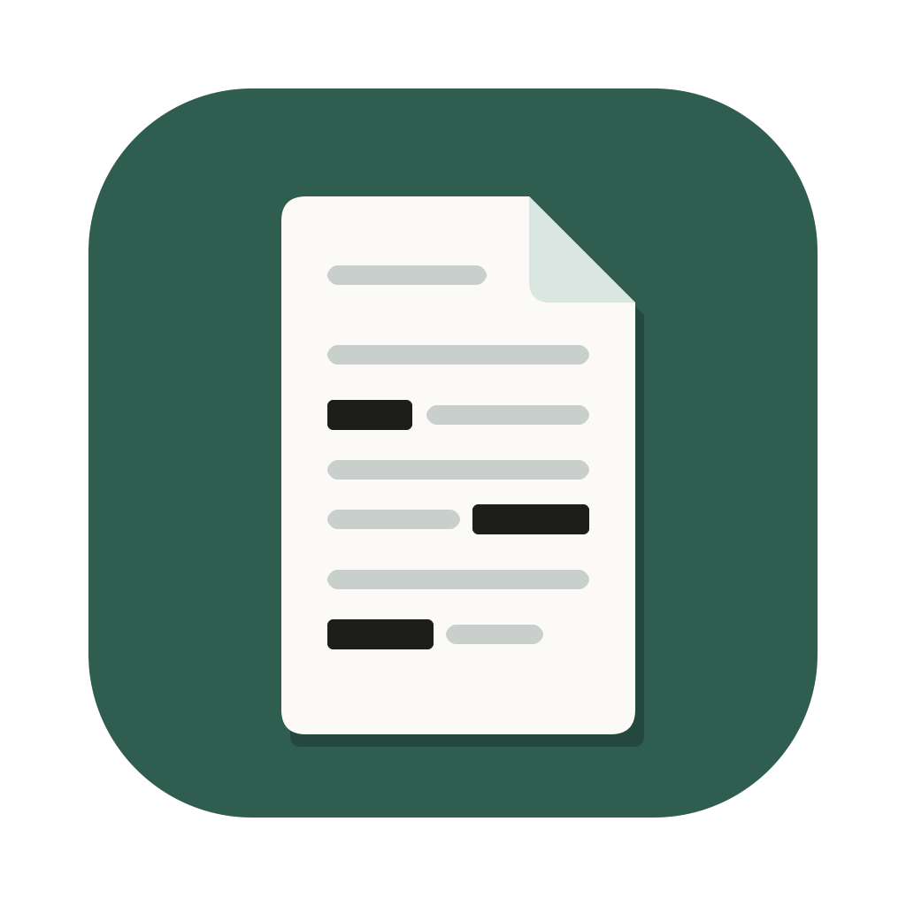
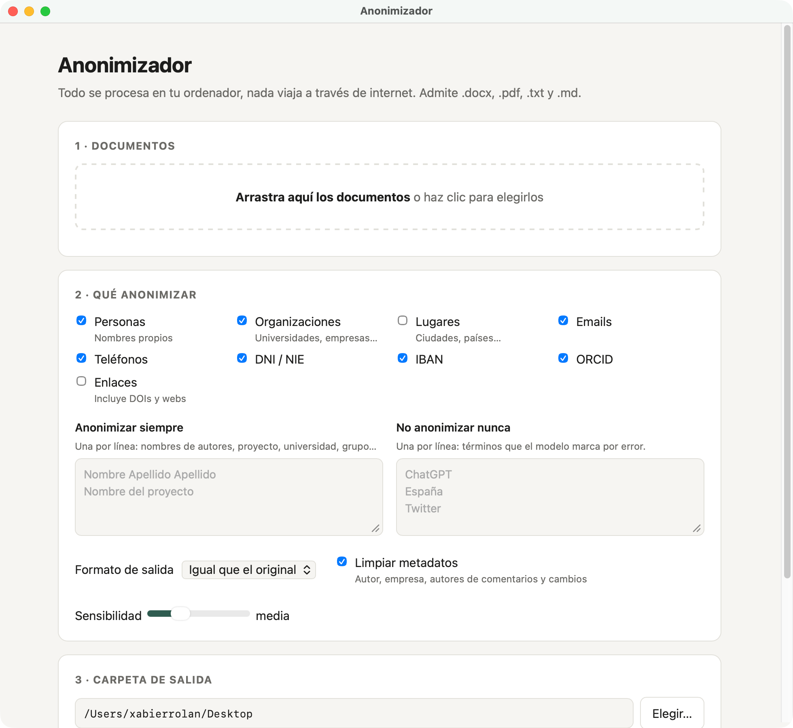

<p align="center"></p>

# Anonimizador

Aplicación de escritorio para anonimizar documentos de investigación y manuscritos antes de compartirlos o enviarlos a revisión ciega. Detecta nombres, instituciones, correos, teléfonos, DNI/NIE, IBAN, ORCID y otros datos personales, y los sustituye por marcadores (`[PERSONA_1]`, `[ORGANIZACION_2]`…) o, en PDF, los tapa.

**Todo se procesa en el ordenador: ningún documento sale a internet.**

<p align="center"></p>

## Qué hace

- **Formatos de entrada:** `.docx`, `.pdf`, `.txt` y `.md`. Se pueden procesar varios a la vez.
- **Formatos de salida:**
  - *Igual que el original.* En Word conserva el formato (negritas, tablas, notas). En PDF tapa los datos con recuadros negros y mantiene la maquetación.
  - *Markdown (`.md`).* Conserva títulos, listas, tablas y notas al pie.
- **Marcadores coherentes:** la misma persona recibe el mismo marcador en todos los documentos de un lote, lo que resulta útil para entrevistas o corpus.
- **Listas personalizadas:** términos que se anonimizan siempre (nombres de autores, proyecto, grupo…) y términos que no se anonimizan nunca (falsos positivos).
- **Limpieza de metadatos:** autor, empresa y autores de comentarios y control de cambios en Word, y metadatos del PDF.
- **Informe por documento** con todo lo que se ha sustituido, para revisarlo.

> **Importante:** la detección automática no es infalible. Revisa siempre la lista de elementos anonimizados antes de difundir un documento. La herramienta no sustituye la revisión humana ni el cumplimiento del RGPD.

## Instalación

La app es autocontenida: no hay que instalar Python ni ninguna dependencia. Descárgala desde la sección [Releases](../../releases).

### macOS

1. Descarga `Anonimizador.dmg`.
2. Ábrelo y arrastra **Anonimizador** a la carpeta Aplicaciones.
3. La primera vez, macOS avisará de que la app no procede de un desarrollador identificado. Haz clic derecho sobre la app → **Abrir**, o ve a *Ajustes del Sistema → Privacidad y seguridad → Abrir igualmente*.

Requisitos: Mac con Apple Silicon (M1 o posterior) y macOS 14 o superior.

### Windows

1. Descarga `Anonimizador-Windows.zip`.
2. Haz clic derecho sobre él → **Extraer todo** y guarda la carpeta donde quieras (por ejemplo, en Documentos).
3. Abre `Anonimizador.exe`, dentro de la carpeta extraída. La primera vez, Windows SmartScreen avisará de que la app no está firmada: pulsa **Más información → Ejecutar de todas formas**.

Requisitos: Windows 11 de 64 bits. También debería funcionar en Windows 10 con Microsoft Edge actualizado (la ventana usa su motor, WebView2), aunque no se ha probado. Para tenerla a mano, haz clic derecho sobre `Anonimizador.exe` → **Anclar a Inicio**.

## Uso desde el código

Con [uv](https://docs.astral.sh/uv/):

```sh
uv sync
uv run python main.py          # ventana nativa
uv run python anonimizador.py  # interfaz en el navegador (http://127.0.0.1:8765)
```

Para compilar la app de macOS y la `.dmg` (en `dist/`):

```sh
./build/build.sh
```

La versión de Windows la compila [GitHub Actions](.github/workflows/windows.yml) al publicar una release: genera el `.zip`, comprueba que la app anonimiza correctamente (`Anonimizador.exe --selftest informe.txt`) y lo adjunta a la release. También se puede lanzar a mano desde la pestaña *Actions*.

## Software empleado

| Componente | Función | Licencia |
|---|---|---|
| [Presidio](https://github.com/microsoft/presidio) (Microsoft) | Detección de datos personales | MIT |
| [spaCy](https://spacy.io) (Explosion) | Análisis lingüístico | MIT |
| [es_core_news_lg](https://spacy.io/models/es) | Modelo de español | GPL-3.0 |
| [PyMuPDF y pymupdf4llm](https://pymupdf.readthedocs.io) (Artifex) | Lectura, tachado y conversión de PDF | AGPL-3.0 |
| [pywebview](https://pywebview.flowrl.com) | Ventana nativa | BSD-3-Clause |
| [Python](https://www.python.org) | Lenguaje | PSF |

## Autoría y licencia

© 2026 Universidade de Vigo. Desarrollo: Xabier Martínez Rolán (xabier.rolan@uvigo.gal).

- **Código:** [GNU AGPL-3.0](LICENSE). Es la licencia que exigen las dependencias de PDF (PyMuPDF), y es compatible con la del modelo de español (GPL-3.0).
- **Icono y documentación:** [CC BY 4.0](https://creativecommons.org/licenses/by/4.0/deed.es).

Desarrollado con la ayuda de Claude (Anthropic).
